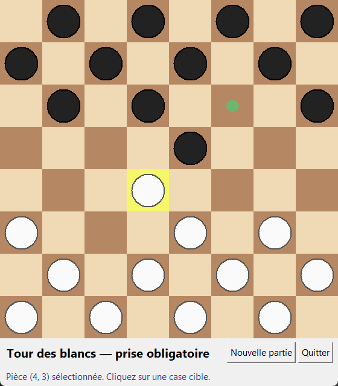

# Jeu de dames — Python / Tkinter

> *A two-player checkers game in Python with a Tkinter GUI and a console mode. Rules engine fully unit-tested.*

Un jeu de dames à deux joueurs sur un même ordinateur, avec une interface graphique Tkinter et une version console.



## Fonctionnalités

- Interface graphique : cliquez sur une pièce, puis sur la case où la déplacer.
- Les déplacements possibles de la pièce sélectionnée sont indiqués par un point vert.
- **Prise obligatoire** : si une prise est possible, le joueur doit la faire.
- **Prises multiples** : après une prise, la même pièce doit continuer tant qu'elle peut encore prendre.
- Promotion en **dame** (anneau doré) en atteignant la dernière rangée.
- Indicateur du joueur courant, messages d'erreur clairs, détection de la fin de partie.
- Boutons *Nouvelle partie* et *Quitter*; le damier se redimensionne avec la fenêtre.
- Version console jouable au clavier.

### Règles (version simplifiée)

- Plateau 8 × 8, 12 pièces par joueur, les blancs commencent.
- Un pion avance d'une case en diagonale; une dame se déplace d'une case dans les quatre directions.
- Une prise se fait en sautant par-dessus une pièce adverse, vers l'avant ou l'arrière.
- Un joueur qui ne peut plus jouer (plus de pièces ou pièces bloquées) perd la partie.

## Lancer le jeu

Python 3.8+ suffit, aucune dépendance externe (Tkinter est inclus avec Python).

```bash
python -m checkers            # interface graphique
python -m checkers --console  # version console
```

## Tests

```bash
python -m unittest discover -s tests -t .
```

43 tests couvrent les positions, les déplacements, les prises (simples et multiples), la promotion, la fin de partie et la robustesse de la saisie console.

## Structure

```
checkers/
  position.py       Position (ligne, colonne) et diagonales
  piece.py          Pièce (couleur, pion/dame)
  damier.py         Plateau et règles de déplacement
  partie.py         Tours, prise obligatoire, prises multiples, version console
  canvas_damier.py  Dessin du damier (Tkinter Canvas)
  interface.py      Fenêtre principale
tests/              Tests unitaires (unittest)
```

## Crédits

Projet réalisé à l'origine en équipe dans le cadre du cours IFT-1004 (Université Laval, automne 2023)
par Hajid Jeddi, Bilal Draa et Noah Ladouceur, à partir d'un squelette fourni par l'équipe du cours.
Les règles ont ensuite été corrigées, l'interface graphique réécrite et les tests ajoutés par Hajid Jeddi.
